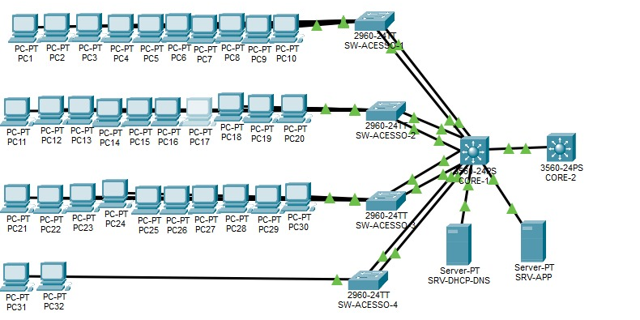

# Rede Corporativa — Alpha Saúde

Projeto prático de rede local (LAN) para uma empresa fictícia que gerencia dados hospitalares. A rede usa dois core switches Layer 3, quatro switches de acesso, segmentação por VLANs e agregação de links com EtherChannel. Foi configurada e validada no **Cisco Packet Tracer**.

## Cenário

A Alpha Saúde tem 32 funcionários, divididos em Gerência, Desenvolvimento e Comercial. A rede precisava ser estritamente local, com segmentação de tráfego, segurança e tolerância a falhas físicas.

## Topologia

## Endereçamento e VLANs

| VLAN | Nome | Rede | Gateway | Switches conectados |
| --- | --- | --- | --- | --- |
| 10 | Gerência | 192.168.10.0/24 | 192.168.10.1 | SW-ACESSO-1 |
| 20 | Desenvolvimento | 192.168.20.0/24 | 192.168.20.1 | SW-ACESSO-2 |
| 30 | Comercial | 192.168.30.0/24 | 192.168.30.1 | SW-ACESSO-3 e SW-ACESSO-4 |
| 40 | Servidores | 192.168.40.0/24 | 192.168.40.1 | CORE-1 (direto) |

## Dispositivos

- 2 core switches Layer 3: CORE-1 (ativo) e CORE-2 (redundância física)
- 4 switches Layer 2 de acesso (SW-ACESSO-1 a 4)
- 2 servidores: SRV-DHCP-DNS e SRV-APP
- 32 PCs distribuídos nos switches de acesso

## O que foi configurado

- **VLANs** para separar os setores e os servidores
- **Roteamento entre VLANs** no CORE-1, com interfaces VLAN como gateways
- **EtherChannel com LACP** entre cada switch de acesso e o CORE-1
- **Trunk** com as VLANs 10, 20, 30 e 40 permitidas
- **DHCP Relay** no CORE-1, encaminhando as requisições das VLANs 10, 20 e 30 para o servidor DHCP (192.168.40.10)
- **PortFast e BPDU Guard** nas portas de acesso

### Uplinks EtherChannel

| Switch de acesso | Portas no acesso | Portas no CORE-1 | Channel-Group |
| --- | --- | --- | --- |
| SW-ACESSO-1 | Fa0/23-24 | Fa0/1-2 | 1 |
| SW-ACESSO-2 | Fa0/23-24 | Fa0/3-4 | 2 |
| SW-ACESSO-3 | Fa0/23-24 | Fa0/5-6 | 3 |
| SW-ACESSO-4 | Fa0/23-24 | Fa0/7-8 | 4 |

## Como validar

| Teste | Comando ou ação | O que verifica |
| --- | --- | --- |
| VLANs | `show vlan brief` | VLANs 10, 20, 30 e 40 criadas |
| EtherChannel | `show etherchannel summary` | Os 4 Port-Channels ativos |
| Roteamento | `show ip route` e `show ip interface brief` | Redes e interfaces VLAN funcionando |
| DHCP | No PC: Desktop > IP Configuration > DHCP | PC recebe IP da sua VLAN |
| Entre VLANs | `ping 192.168.40.10` | PC alcança o servidor da VLAN 40 |
| Entre switches | Ping entre PCs de switches de acesso diferentes | Comunicação entre os switches |

## Possíveis melhorias

- Configurar um protocolo de redundância de gateway entre os dois cores, para o CORE-2 assumir de fato em caso de falha
- Adicionar listas de controle de acesso (ACLs) para limitar o tráfego entre VLANs
- Ativar port security nas portas de acesso

## Arquivos

- `README.md`: documentação da rede
- `comandos-cli.txt`: comandos usados na configuração e validação
- `trabalho-de-redes (1).pkt`: arquivo do Cisco Packet Tracer

## Equipe

Guilherme Mattos dos Santos. 
Renato Campos Lopes, João Marcos dos Santos Antunes.
Phillipe Santana Gonzaga. 
Douglas Gabriel Barboza Freitas. 
e Leonardo Lisboa dos Santos. 
